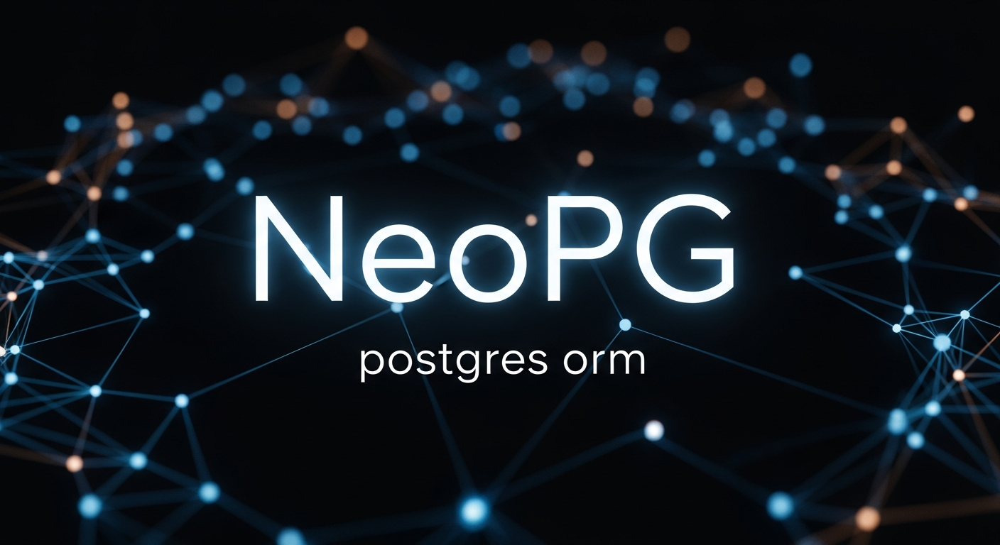

# NeoPG

### The Next Generation PostgreSQL ORM for Node.js

**NeoPG** is a high-performance, zero-dependency ORM built directly on top of [postgres.js](https://github.com/porsager/postgres) — the fastest PostgreSQL client for Node.js.

It bridges the gap between the developer experience (DX) of a chainable Query Builder and the raw performance of native SQL Template Literals.

### [🪭 中文文档 ☯️](./README.cn.md)

## 🚀 Key Features

*   **Powered by [postgres.js](https://github.com/porsager/postgres)**: Inherits the incredible speed and stability of the fastest PG client.
*   **Zero Dependencies**: The core driver is vendored and optimized internally. No heavy dependency tree.
*   **Hybrid API**: Enjoy the ease of **Chainable/Fluent APIs** (like `.where().select()`) combined with the power of **Tagged Template Literals**.
*   **Performance First**: Zero string concatenation logic. All queries are compiled into efficient fragments and executed natively.
*   **Auto Schema Sync**: define your models in code, and NeoPG syncs the table structure, indices, and foreign keys automatically.
*   **Type Smart**: Automatic type casting for aggregations (`sum`, `avg` returns numbers, not strings) and JSON handling.

---

## 📦 Installation

```bash
npm install neopg
```

> Requires **Node.js >= 24**.

---

## 🧩 ESM and CommonJS

NeoPG 3.x is published as ESM with a CommonJS entry, so pick whichever matches your project.

### ESM project (`"type": "module"`, recommended)

```javascript
// Default import gives you the NeoPG class
import NeoPG from 'neopg'

// Named imports give you the helpers and base class
import { dataTypes, ModelChain, SchemaSync } from 'neopg'

const db = new NeoPG(config)
```

Model files use `export default`:

```javascript
// models/User.js
import { dataTypes, ModelChain } from 'neopg'

export default class User extends ModelChain {
  static schema = {
    tableName: 'users',
    column: { id: { type: dataTypes.UID } }
  }
}
```

### CommonJS project (`require`)

```javascript
// Exactly like 2.x — you get the NeoPG class itself
const NeoPG = require('neopg')

// Destructuring still works
const { dataTypes, ModelChain } = require('neopg')

const db = new NeoPG(config)
```

Model files use `module.exports`:

```javascript
// models/User.js
const { dataTypes, ModelChain } = require('neopg')

class User extends ModelChain {
  static schema = {
    tableName: 'users',
    column: { id: { type: dataTypes.UID } }
  }
}

module.exports = User
```

### Side by side

| Task | ESM | CommonJS |
| :--- | :--- | :--- |
| Import NeoPG | `import NeoPG from 'neopg'` | `const NeoPG = require('neopg')` |
| Import helpers | `import { dataTypes, ModelChain } from 'neopg'` | `const { dataTypes, ModelChain } = require('neopg')` |
| Export a model | `export default User` | `module.exports = User` |
| Load models | `await db.loadModels('./models')` | `await db.loadModels('./models')` |

> `loadModels()` / `loadFiles()` detect each file's module type automatically and load
> **ESM first** (`import()`), falling back to `require()` only when the entry cannot be
> resolved by the ESM loader. So `.mjs` models inside a CJS project and `.cjs` models
> inside an ESM project both work without any extra argument.

## 🔌 Initialization

### Connect to Database

```javascript
// ESM (recommended)
import NeoPG from 'neopg'

// CommonJS (still supported)
const NeoPG = require('neopg')

const config = {
  host: 'localhost',
  port: 5432,
  database: 'my_db',
  user: 'postgres',
  password: 'password',
  max: 10,             // Connection pool size
  idle_timeout: 30,    // Idle connection timeout in seconds
  debug: false,        // Enable query logging
  schema: 'public'     // Default schema
};

const db = new NeoPG(config);
```

> **Module format**: NeoPG 3.x is ESM-first (`"type": "module"`) and requires **Node.js >= 24**.
> A CommonJS entry (`index.cjs`) is shipped, so `require('neopg')` keeps working unchanged.

### Close Connection

```javascript
await db.close()
```

---

## 📝 Defining a Model

Create a model file (e.g., `models/User.js`). Your class should extend the `ModelChain` base class
(also reachable as `NeoPG.ModelChain`).

The example below uses CommonJS; if your project is ESM, swap the first line for
`import { ModelChain, dataTypes } from 'neopg'` and the last line for
`export default User` — the schema itself is identical either way.

```javascript
const { ModelChain, dataTypes } = require('neopg')

class User extends ModelChain {
  static schema = {
    tableName: 'users',
    modelName: 'User', // Optional, defaults to tableName
    primaryKey: 'id',
    
    // Auto-sync table structure based on this definition
    column: {
      id: { 
        type: dataTypes.ID, // Auto-generates Snowflake-like ID 
      },
      username: { 
        type: dataTypes.STRING(100), 
        required: true 
      },
      email: { 
        type: dataTypes.STRING(255), 
        required: true 
      },
      age: { 
        type: dataTypes.INT, 
        default: 18 
      },
      meta: { 
        type: dataTypes.JSONB 
      },
      created_at: {
        type: dataTypes.BIGINT,
        timestamp: 'insert' // Auto-fill on insert
      },
      updated_at: {
        type: dataTypes.BIGINT,
        timestamp: 'update' // Auto-fill on insert & update
      }
    },

    // Indexes
    index: ['email', 'age'],
    unique: ['username']
  }
}

module.exports = User
```

## 🛠 CLI Model Generator

NeoPG includes a built-in CLI tool to quickly generate model files with boilerplate code.

### Usage

Run via `npx` (no global installation required):

```bash
npx neopg-model [options] [model_names...]
```

### Options

*   `--dir=<path>`: Specify the output directory (default: `./model`).

### Examples

**1. Basic Generation**
```bash
npx neopg-model user
# Creates: ./model/user.js
# Class: User
# Table: user
```

**2. Naming Convention (Hyphenated)**
NeoPG automatically converts hyphenated names to **CamelCase** for the class and **snake_case** for the table.

```bash
npx neopg-model user-log
# Creates: ./model/user-log.js
# Class: UserLog
# Table: user_log
```

**3. Multiple Models & Custom Directory**
```bash
npx neopg-model --dir=./src/models product order-item
# Creates:
#   ./src/models/product.js
#   ./src/models/order-item.js
```

**4. ES Modules (.mjs)**
If you suffix the name with `.mjs`, it generates ESM syntax (`export default`).
```bash
npx neopg-model config.mjs
```

> The generated code imports `neopg` as `import { dataTypes, ModelChain } from 'neopg'`,
> so it works both in ESM projects and in CJS projects (where `loadModels()` / `loadFiles()`
> resolve it through the ESM-first loader).

---

## ⚙️ Registration & Sync

Initialize NeoPG and register your models. You can define models using classes or configuration objects.

### Registering Models

NeoPG provides three methods for registration:

*   **`define(model)`**: The standard method. Throws an error if a model with the same name already exists.
*   **`add(model)`**: Alias for `define`.
*   **`set(model)`**: **Overwrites** the existing model if the name conflicts. Useful for hot-reloading or dynamic schema updates.

```javascript
// CJS project
const User = require('./models/User')

// ESM project — same thing
// import User from './models/User.js'

// 1. Standard Registration (Safe)
// Will throw error: "[NeoPG] modelName conflict: User" if registered twice
db.define(User)

// 2. Force Overwrite (Reset)
// Updates the definition for 'User' even if it exists
db.set(User)

// 3. Register using a plain object (Quick prototype)
db.define({
  tableName: 'logs',
  column: {
    message: 'string',
    level: 'int'
  }
})

console.log(db.has('User'))

```

### Syncing Database

Sync the table structure to the database based on registered models.

```javascript
// Sync Table Structure (DDL)
// options: { force: true } will drop columns not defined in schema
await db.sync({ force: false })

console.log('Database synced!')
```

---

### 📂 Auto-loading Models

Instead of manually importing and defining each model, you can load all models from a directory.

**Rules:**
*   Files with `.js`, `.mjs` and `.cjs` extensions are loaded.
*   Files starting with `_` are ignored (useful for utils/helpers).
*   Files starting with `!` are ignored (useful for disabled models).

**The three `modtype` values:**

| Value | Behaviour |
| :--- | :--- |
| `'auto'` (default) | Loads via `import()` first (handles ESM, ESM with top-level `await`, and CJS); falls back to `require()` only when the ESM loader cannot resolve the entry. |
| `'esm'` | Forces `import()`. |
| `'cjs'` | Forces `require()`; `.mjs` files are still treated as ESM. |

> The actual module kind is decided by Node: `.mjs` is ESM, `.cjs` is CommonJS, and for
> `.js` it depends on the `type` field of the nearest `package.json`.

```javascript
const db = new NeoPG(config)

// Load all models from the './models' directory
// The module type of each file is detected automatically, no second argument needed
await db.loadModels('./models')

// Pass 'esm' or 'cjs' only if you want to force a specific type
await db.loadModels('./esmodels', 'esm')

// Load a list of files (also auto-detected)
await db.loadFiles(['./models2/WxUser.js', './models2/Role.js'])

// Now you can sync and use them
await db.sync()
```

> **Model file rules**: a model may be CommonJS (`module.exports = User`) or ESM
> (`export default User`). Both can live in the same directory, and ESM models with
> top-level `await` are supported too. In `auto` mode files are loaded **as ESM first**.

---

## 🔍 Querying

NeoPG provides a fluent, chainable API that feels natural to use.

### Basic Find

```javascript
// Get all users
const users = await db.model('User').find();

// Select specific columns
const users = await db.model('User')
  .select('id, username')
  .limit(10)
  .find();

// Get a single record
const user = await db.model('User').where({ id: '123' }).get();

// Pagination
const page2 = await db.model('User')
                      .select(['id', 'username', 'role'])
                      .page(2, 20)
                      .find(); // Page 2, Size 20
```

### Chained Where

```javascript
await db.model('User')
  .where({ 
    age: 18, 
    status: 'active' 
  })
  .where('create_time', '>', 1600000000)
  .where('id IS NOT NULL')
  .select(db.sql`id, username, role`)
  .find()
```

### Complex Where with Template Literals

This is where NeoPG shines. You can mix raw SQL fragments safely using the `sql` tag from the context.

```javascript
// db.sql is the native postgres instance
const { sql } = db; 

await db.model('User')
  .where({ status: 'active' })
  // Safe parameter injection via Template Literals
  .where(sql`age > ${20} AND email LIKE ${'%@gmail.com'}`)
  .find();
```

---

## 📊 Aggregation

NeoPG handles type casting automatically (e.g., converting PostgreSQL `count` string results to Javascript Numbers).

```javascript
// Count
const total = await db.model('User').where({ age: 18 }).count();

// Max / Min
const maxAge = await db.model('User').max('age');

// Sum / Avg (Returns Number, not String)
const totalScore = await db.model('User').sum('score');
const avgScore = await db.model('User').avg('score');

// Group By
const stats = await db.model('User')
  .select('city, count(*) as num')
  .group('city')
  .find();
```

---

## ✏️ Write Operations

### Insert

```javascript
// Insert one
const newUser = await db.model('User').insert({
  username: 'neo',
  email: 'neo@matrix.com'
})
// ID and Timestamps are automatically generated if configured in Schema

// Insert multiple (Batch)
await db.model('User').insert([
  { username: 'a' }, 
  { username: 'b' }
])
```

### Update

```javascript
const updated = await db.model('User')
  .where({ id: '123' })
  .update({
    age: 99,
    meta: { role: 'admin' }
  });
```

### Delete

```javascript
await db.model('User')
  .where('age', '<', 10)
  .delete();
```

### Returning Data

By default, write operations might not return data depending on the driver optimization. You can enforce it:

```javascript
const deletedUsers = await db.model('User')
  .where('status', 'banned')
  .returning('id, username') // or returning('*')
  .delete();
```

---

## ⚡ Raw SQL (Template Literals)

NeoPG exposes the full power of `postgres.js`. You don't need the ModelChain for everything.

> 📚 **Reference**: Full documentation for the SQL tag can be found at the [postgres.js GitHub page](https://github.com/porsager/postgres).

```javascript
// Access the native driver
const sql = db.sql;

// Execute raw SQL safely
const users = await sql`
  SELECT * FROM users 
  WHERE age > ${20}
`;

// Dynamic tables/columns using helper
const table = 'users';
const column = 'age';
const result = await sql`
  SELECT ${sql(column)} 
  FROM ${sql(table)}
`;
```

---

## 🤝 Transactions

NeoPG provides a unified transaction API. It supports nested transactions (Savepoints) automatically.

### Using NeoPG Context (Recommended)

```javascript
// Start a transaction scope
const result = await db.transaction(async (tx) => {
  // 'tx' is a TransactionScope that mimics 'db'
  
  // 1. Write operation
  const user = await tx.model('User').insert({ username: 'alice' });
  
  // 2. Read operation within transaction
  const count = await tx.model('User').count()
  
  // 3. Throwing an error will automatically ROLLBACK
  if (count > 100) {
    throw new Error('Limit reached')
  }
  
  return user
})
```

### Using Raw Postgres Transaction

```javascript
await db.sql.begin(async (sql) => {
  // sql is the transaction connection
  await sql`INSERT INTO users (name) VALUES ('bob')`;
})
```

---

## ⬆️ Upgrading from 2.x

NeoPG 3.0 moves the package and every source file to native ESM and upgrades the
vendored driver to postgres.js v4.

**What changed**

*   `package.json` now declares `"type": "module"`, with `"node": ">=24"`.
*   All of `lib/`, `bin/` and the entry point use `import` / `export`.
*   The bundled driver is postgres.js **v4** (ESM), replaced in place under `postgres/`.
*   `infer` is passed to the driver as `true` by default, preserving 2.x parameter
    semantics (e.g. `Buffer` → `bytea`). Pass `infer: false` to opt into v4's default.

**What still works unchanged**

*   `require('neopg')` — a CommonJS entry (`index.cjs`) is shipped, so existing
    `const NeoPG = require('neopg')` and `const { dataTypes, ModelChain } = require('neopg')`
    keep working.
*   `db.sql` is still the native postgres instance, so `sql\`...\``, `sql.unsafe()`,
    `sql(...)` identifiers, `db.transaction()` and `db.listen()` / `db.notify()` are unaffected.
*   Model files may be CJS or ESM. `loadModels()` / `loadFiles()` now detect the module
    type per file, so the second `modtype` argument is optional (defaults to `'auto'`).
    `auto` loads **ESM first** via `import()` and only falls back to `require()` when the
    ESM loader cannot resolve the entry. Mixing `.js` / `.mjs` / `.cjs` in one directory
    works, including ESM with top-level `await`.

**Action required**

*   Your own project must run on Node.js >= 24 if it consumes NeoPG as ESM.
*   If you generate models with `npx neopg-model`, the default output is still CJS;
    append `.mjs` to get an ESM model.

---

## License

ISC


